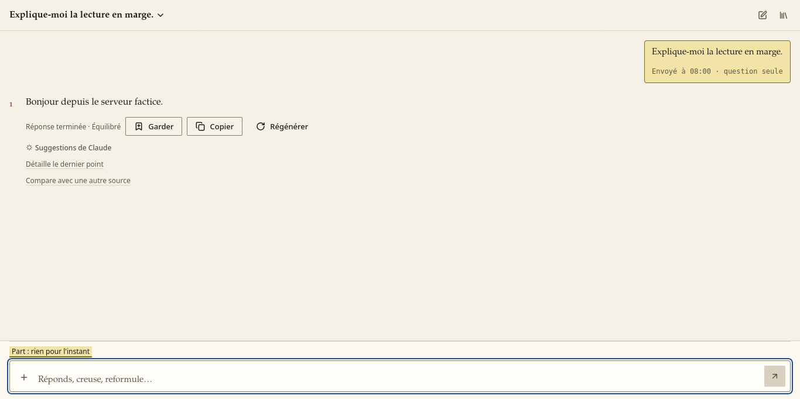
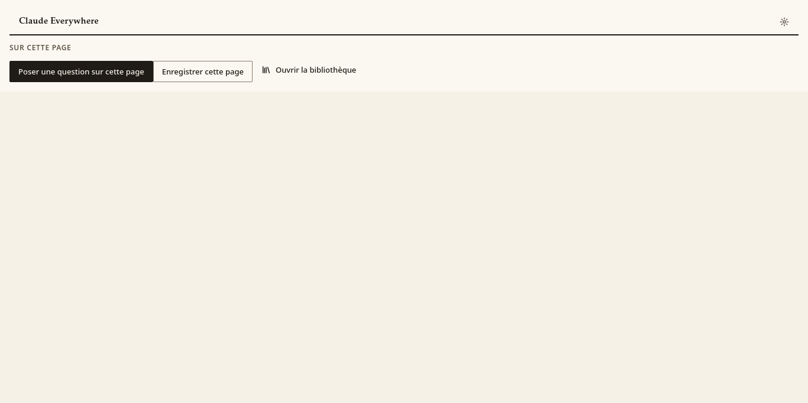
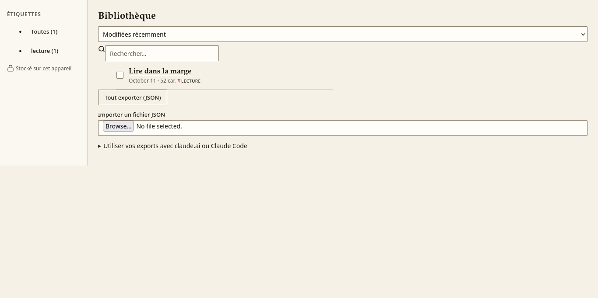
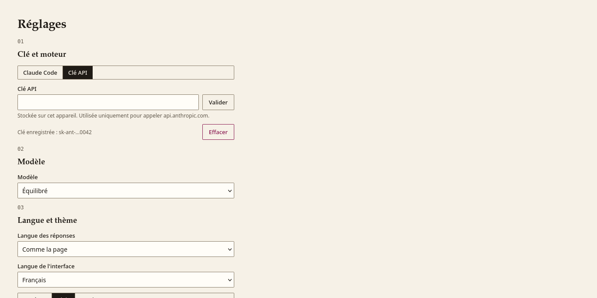

# Claude Everywhere

Extension Firefox (Manifest V3) : posez une question à Claude sur la page que vous lisez, gardez les réponses utiles dans une bibliothèque locale.

| Panneau latéral | Fenêtre rapide | Bibliothèque | Réglages |
| --- | --- | --- | --- |
|  |  |  |  |

Les variantes sombres sont dans `docs/screenshots/*-dark.png`.

## Ce que fait l'extension

- Lit la page active (ou la sélection, ou un PDF) et la transmet à Claude, via l'API d'Anthropic, uniquement sur action explicite.
- Affiche les réponses en Markdown dans un panneau latéral, en flux.
- Enregistre pages et réponses (« artefacts ») dans une bibliothèque locale consultable.

## Installation temporaire (développement)

1. `npm ci && npm run build` produit le dossier `dist/`.
2. Ouvrir `about:debugging#/runtime/this-firefox`.
3. Cliquer sur « Charger un module complémentaire temporaire… » puis choisir `dist/manifest.json` (ou l'archive `artifacts/claude_everywhere-<version>.zip`).

Le module disparaît à la fermeture de Firefox. Firefox 140 ou plus récent est requis.

## Signature et publication sur AMO

Pré-requis : Node.js 22 ou plus (champ `engines`), dépendances figées par `package-lock.json`.

```
npm ci
npm run package
```

`npm run package` nettoie `dist/` et `artifacts/`, reconstruit, puis lance `web-ext build`. Il produit dans `artifacts/` :

- `claude_everywhere-<version>.zip`, l'archive à téléverser ;
- `claude_everywhere-<version>.xpi`, une copie identique avec l'extension `.xpi`.

**Signature.** Créer des identifiants API sur addons.mozilla.org (Outils pour développeurs, « Gérer les identifiants API »), puis :

```
npx web-ext sign -s dist -a artifacts --channel=unlisted --api-key=<JWT issuer> --api-secret=<JWT secret>
```

- `--channel=listed` publie sur la fiche publique d'AMO (relecture par l'équipe de Mozilla) ; `--channel=unlisted` signe un `.xpi` à distribuer soi-même.
- Ne jamais enregistrer l'identifiant ni le secret dans le dépôt ; passer par des variables d'environnement (`WEB_EXT_API_KEY`, `WEB_EXT_API_SECRET`).
- Le manifeste déclare `data_collection_permissions: { required: ["websiteContent"] }` : le contenu des pages est transmis à l'API d'Anthropic sur action de l'utilisateur. Le formulaire AMO doit rester cohérent avec cette déclaration.

**Code source.** Le code étant empaqueté et minifié par esbuild, AMO demande l'archive des sources. La produire à partir d'un arbre propre et validé :

```
git archive --format=zip --prefix=claude-everywhere-<version>/ -o artifacts/claude_everywhere-<version>-source.zip HEAD
```

La joindre à la soumission avec ces instructions : Node.js 22, `npm ci`, `npm run package`, résultat dans `artifacts/`.

## Clé d'API

1. Créer une clé dans la Console Anthropic (console.anthropic.com).
2. L'ouvrir dans les réglages de l'extension et la coller dans le champ prévu.

La clé est stockée dans `storage.local` uniquement et n'est envoyée nulle part ailleurs qu'à l'API d'Anthropic. Un abonnement claude.ai ne donne pas accès à l'API : une clé de la Console, facturée séparément, est nécessaire.

## Utilisation

- **Panneau latéral** : conversation avec Claude sur la page active.
- **Fenêtre rapide** (icône de la barre d'outils) : question rapide ou enregistrement de la page.
- **Surcouche de sélection** : sélectionner du texte dans une page ouvre une surcouche pour l'expliquer ou le poser comme contexte.
- **Menu contextuel** : clic droit sur une sélection ou une page.
- **Enregistrer des pages** : la page lue est conservée dans la bibliothèque.
- **Bibliothèque** : étiquettes, recherche, versions successives d'un artefact, export Markdown ou JSON, et ajout d'artefacts comme contexte d'une nouvelle conversation.
- **Réutiliser les exports** : déposer le fichier `.md` (ou un lot d'artefacts en un seul fichier) dans un Projet claude.ai comme connaissance, ou le référencer depuis un CLI de code (`@fichier`).

## Raccourcis clavier

| Raccourci | Action |
| --- | --- |
| `Ctrl+Shift+Y` | Ouvrir le panneau latéral |
| `Alt+Shift+C` | Ouvrir la fenêtre rapide |
| `Alt+Shift+E` | Expliquer la sélection |
| `Alt+Shift+S` | Enregistrer la page |

Ils se modifient dans `about:addons` (engrenage, « Gérer les raccourcis des modules »).

## Confidentialité

- Rien n'est envoyé sans action explicite de l'utilisateur.
- Chaque envoi affiche le bordereau : éléments transmis et nombre de caractères de chacun.
- Aucune télémétrie ; ni clé ni contenu dans les journaux.
- Les données (bibliothèque, réglages, clé) restent dans le navigateur.

## Permissions

| Permission | Justification |
| --- | --- |
| `storage` | Réglages, clé d'API et bibliothèque locale. |
| `activeTab` | Lire l'onglet actif après un clic, un raccourci ou le menu contextuel. |
| `scripting` | Injecter l'extraction et la surcouche à la demande ; aucun script de contenu statique. |
| `contextMenus` | Entrées du menu contextuel. |
| `https://api.anthropic.com/*` (hôte) | Appels à l'API d'Anthropic. |
| `<all_urls>` (optionnelle) | Demandée seulement si l'utilisateur active la surcouche sur tous les sites ou la lecture directe de l'onglet actif depuis le panneau. |

La CSP des pages d'extension limite `connect-src` à l'API d'Anthropic ; elle autorise aussi `https:` dans le seul but de télécharger un PDF que l'utilisateur demande à lire (décision D-017). Voir `DECISIONS.md` (D-006, D-007).

## Limites

- Il n'existe pas d'API publique pour écrire des artefacts ou des Projets claude.ai : le passage se fait par export (D-009).
- Seuls les PDF en `https` sont lus.
- Les pages privilégiées du navigateur (`about:`, addons.mozilla.org, etc.) ne peuvent pas être lues : coller le texte à la main.
- Le lecteur PDF de Firefox n'offre pas la surcouche de sélection.
- `npm audit --omit=dev` ne signale aucune vulnérabilité (0 sur les dépendances livrées). `npm audit` complet signale 5 avis (dont `shell-quote` via `fx-runner`) dans la chaîne d'outils `web-ext`, uniquement pour le développement et absents de l'extension empaquetée.

## Développement

| Commande | Rôle |
| --- | --- |
| `npm ci` | Installer les dépendances figées |
| `npm run typecheck` | Messages i18n puis `tsc --noEmit` |
| `npm test` | Tests unitaires (vitest) |
| `npm run test:e2e` | Build de test puis suite Firefox de bout en bout |
| `npm run lint` | `web-ext lint` sur `dist/` |
| `npm run audit` | Contrôle des permissions du manifeste de `dist/` |
| `npm run build` | Construit `dist/` |
| `npm run package` | Build propre et archives dans `artifacts/` |

**API factice.** `tests/mock-api/server.ts` simule l'API Anthropic (flux, limites de débit, surcharge, refus, etc.). Le build de test (`npm run build:test`) vise `http://127.0.0.1:8787` (variable `MOCK_PORT`) et produit `dist-test/`. Le serveur se lance seul avec `MOCK_PORT=8787 node --experimental-strip-types tests/mock-api/server.ts`.

## English summary

Claude Everywhere is a Firefox (MV3) extension to ask Claude about the page you are reading and keep useful answers in a local library. Two ways to answer: through your own Anthropic API key (stored in `storage.local` and only ever sent to the Anthropic API; a claude.ai subscription does not include API access), or through your Claude account by way of the local Claude Code CLI on Firefox desktop (run `npm run install:native-host` once, with Claude Code logged in; see `DECISIONS.md` D-019). Nothing is sent without an explicit action, each request shows what is sent with character counts, and there is no telemetry. Build with `npm ci && npm run package` (Node 22+): the add-on zip and a `.xpi` copy land in `artifacts/`. For AMO, submit the zip plus a source archive made with `git archive`. See the sections above (in French) for permissions, shortcuts, limits and development commands.
